<!-- animated contribution graph: real data, boxes reveal cell by cell
     (regenerated daily by .github/workflows/update-profile-art.yml) -->

<h3><code>ratnesh@github ~ $ ./contributions.sh</code></h3>

 
 

<!-- ascii portrait (left, width 370) + neofetch info card (right, width 490).
     portrait: python scripts/prep_photo.py && python scripts/make_ascii_svg.py
     card:     python scripts/make_info_card.py -->

<h3><code>ratnesh@github ~ $ whoami</code></h3>

<table>
<tr>
<td valign="top" width="370"></td>
<td valign="top" width="490"></td>
</tr>
</table>

 
 

<h3><code>ratnesh@github ~ $ ./projects.sh --featured</code></h3>

<!-- REPO-TABLE:START -->
| Project | Description | Demo / Links |
| :--- | :--- | :--- |
| **[compass](https://github.com/Ratnesh-101/compass)** | Autonomous personal AI agent with partitioned long-term memory across hackathons, repos, and coursework. Multi-tier LLM routing with SSE streaming. | [Live Demo](https://compass-farmlytics.vercel.app) |
| **[Syngenta (Kheti Compass)](https://github.com/Ratnesh-101/Syngenta)** | AI-guided field force visit priority engine (0–100) combining 8 agronomic signals with online gradient-feedback learning. *(Syngenta AgriTech Hackathon)* | [Live Demo](https://syngenta-nu.vercel.app) · [API Docs](https://kheti-compass.onrender.com/docs) |
| **[news-360-feedback](https://github.com/Ratnesh-101/news-360-feedback)** | Real-time multilingual news sentiment & policy feedback dashboard for Government of India ministries across regional media. *(SIH 2024)* | [Live Demo](https://news-360-feedback-18052906.streamlit.app/) |
<!-- REPO-TABLE:END -->

 
 

<h3><code>ratnesh@github ~ $ ./connect.sh</code></h3>

  
  &nbsp;
  
  &nbsp;
  

 

  <em>"Bridging autonomous AI reasoning and robust systems engineering to build software that remembers, adapts, and scales."</em>

 

